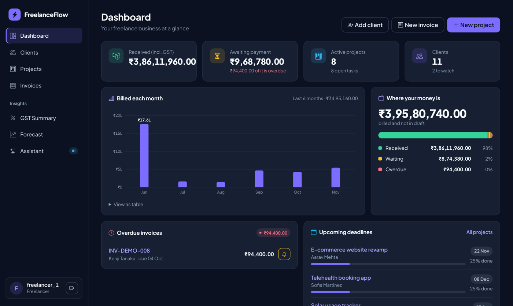
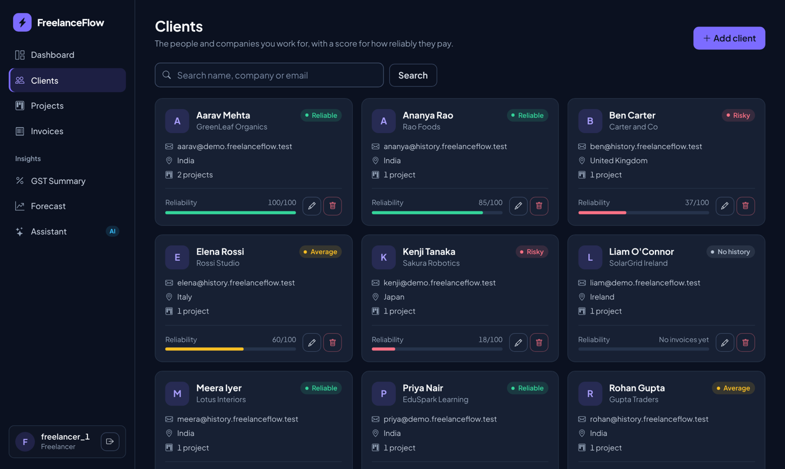
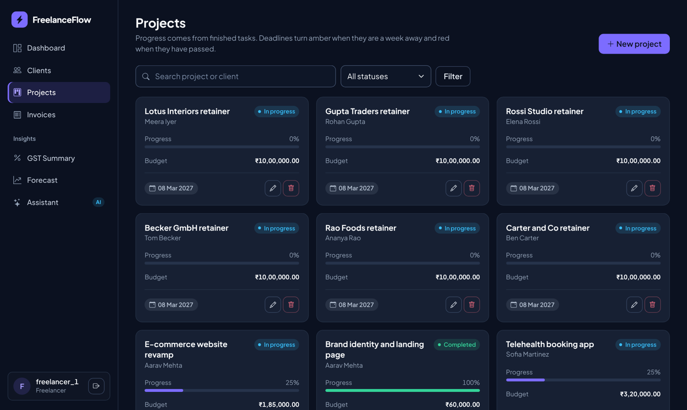
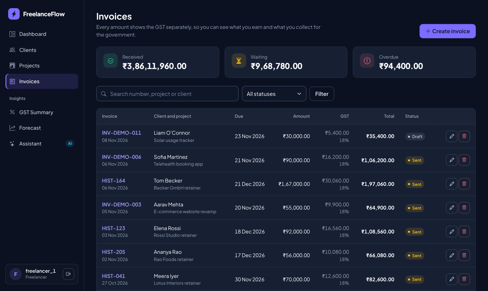
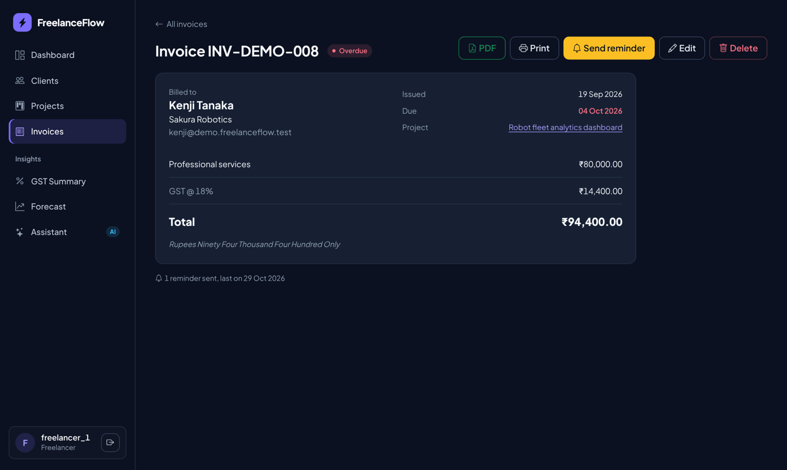
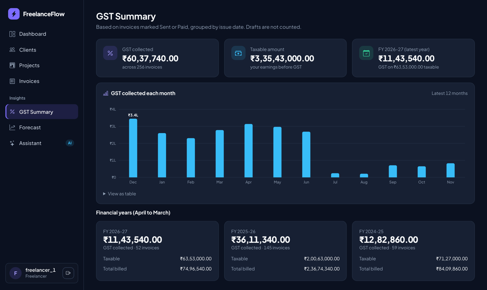
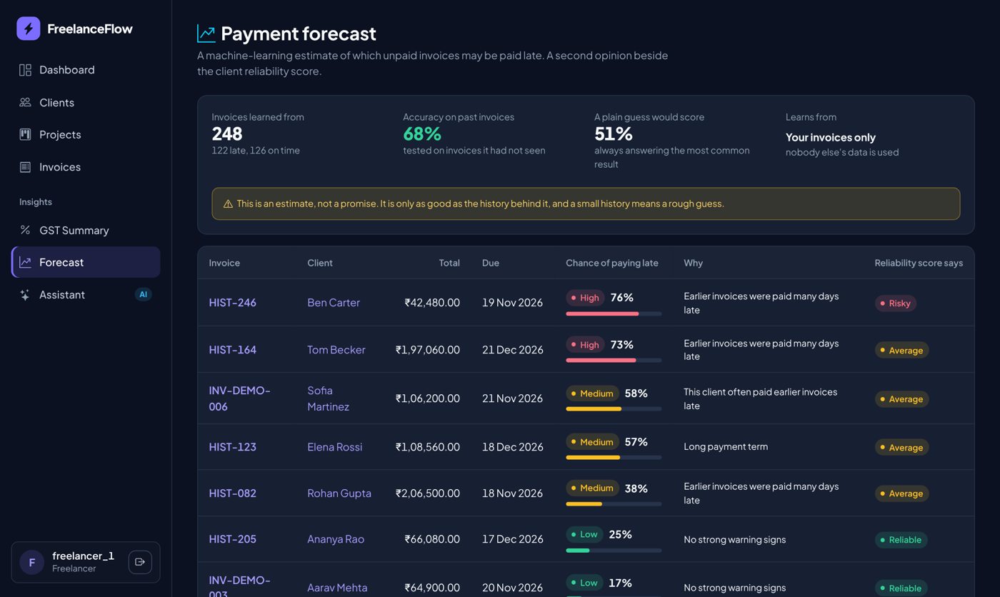
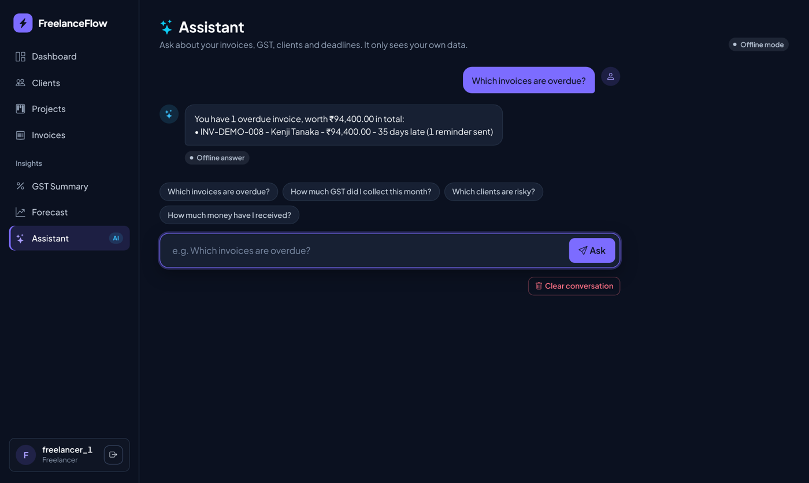

# FreelanceFlow

FreelanceFlow is a web application that helps freelancers manage their clients, projects, invoices and payments in one place.

Freelancers often keep their work records in chats, notebooks and spreadsheets. That makes it hard to know who still owes money, which project is due soon, and how much GST has to be paid. FreelanceFlow brings all of this into one simple website. The freelancer adds clients and projects, creates invoices with GST added automatically, and gets reminders and smart insights about late payments.

Every user has a private account and sees only their own data. No technical knowledge is needed to use it.

## Main features

- **CRUD operations:** create, view, update and delete clients, projects, tasks and invoices.
- **Search, filter and sort:** search clients by name, company or email (listed A to Z), and filter projects and invoices by status.
- **Automatic GST calculation:** enter only the amount. The system adds GST (18% by default, editable per invoice) and calculates the total. A GST summary shows the tax collected by month and by financial year (April to March).
- **Invoices and PDF:** invoices have Draft, Sent and Paid statuses. Overdue invoices are highlighted, and each invoice can be downloaded as a PDF.
- **Reminder emails:** for an overdue invoice, the app prepares a polite payment reminder and keeps count of the reminders sent.
- **Late-payment prediction (scikit-learn):** a logistic regression model learns from the user's past invoices and estimates the chance that each unpaid invoice will be paid late (Low, Medium or High risk). The page shows its accuracy next to a plain guess, so the result can be judged honestly.
- **Client reliability score:** a score from 0 to 100 for every client, based on how late they usually pay. Clients are labelled Reliable, Average or Risky.
- **AI assistant (Google Gemini):** ask questions in plain English, such as "Which invoices are overdue?", and get answers from your own data. If Gemini is unavailable, a backup model and then an offline assistant answer instead.
- **Dashboard:** money received and awaiting payment, active projects, monthly billing chart, overdue invoices and upcoming deadlines.
- **Secure by design:** login is required, passwords are stored as hashes, and every record belongs to its owner.

## Screenshots

### Dashboard

### Clients

### Projects

### Invoices

### Invoice details with PDF download and reminder

### GST summary

### Late-payment prediction

### AI assistant

The screenshots use made-up demo data.

## Tech stack

- **Language:** Python
- **Framework:** Django
- **Database:** MySQL
- **Frontend:** HTML, CSS, Bootstrap
- **PDF generation:** xhtml2pdf
- **Machine learning:** scikit-learn
- **AI:** Google Gemini API (LLM tool calling)
- **Version control:** Git, GitHub
